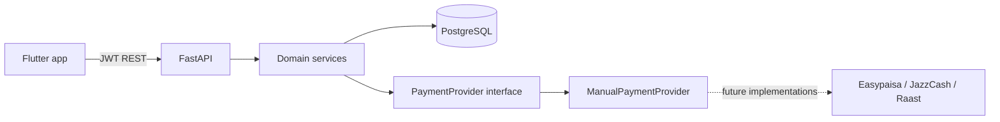

# GroupPay

GroupPay is a mobile-first group expense app for friends and trips. It supports shared groups, expense splitting, net balances, debt simplification, and a manual settlement workflow with an auditable request/claim/confirm lifecycle.

**No real payment provider is currently integrated.** Easypaisa, JazzCash, Raast, bank, and card transfers happen outside GroupPay. A payer can mark a transfer as paid; the receiver must confirm it before balances change.

## MVP features

- Email/password registration and login with JWT access/refresh tokens and secure mobile storage.
- User search, friend requests, accepted friends, groups, membership roles, and expense editing controls.
- PKR expenses with equal, exact, percentage, and share based allocation.
- Backend balance calculation and optimized transfer suggestions.
- Manual settlement request, claim paid, confirm, reject, and cancel flows; partial requests; per-pair outstanding limits; event history; in-app notifications.
- Flutter Material 3 screens for home, groups, expenses, balances, payment requests, settlement details/history, notifications, friends, search, and profile.

## Architecture



The settlement domain depends on a `PaymentProvider` boundary. The current `ManualPaymentProvider` explicitly reports that no external payment was created. Future providers can implement that interface without putting provider calls in expense or balance logic.

## Technology stack and layout

- Backend: Python 3.11+, FastAPI, SQLAlchemy 2, Alembic, Pydantic, PostgreSQL, pytest, Ruff.
- Mobile: Flutter, Dart, Riverpod, go_router, Dio, flutter_secure_storage.

```text
backend/app/api/routes/       REST endpoints
backend/app/models/           SQLAlchemy entities
backend/app/services/         Expense, balance, notification, settlement logic
backend/app/payments/         PaymentProvider abstraction
backend/migrations/           Alembic migrations
backend/tests/                API, calculation, and lifecycle tests
mobile/lib/core/              API, auth, storage, routing, theme
mobile/lib/features/          Screens and API repository
```

## Requirements

- Python 3.11 or newer
- PostgreSQL 14 or newer
- Flutter stable and an Android emulator/device

## PostgreSQL setup

Create an application database (choose a strong local password):

```sql
CREATE USER grouppay WITH PASSWORD 'change-this-password';
CREATE DATABASE grouppay OWNER grouppay;
```

## Backend setup and run

PowerShell:

```powershell
cd backend
py -3.11 -m venv .venv
.\.venv\Scripts\Activate.ps1
pip install -r requirements.txt
Copy-Item .env.example .env
```

Edit `backend/.env`. Set a long random `JWT_SECRET_KEY`, the PostgreSQL `DATABASE_URL`, and `CORS_ORIGINS` for your client. Then:

```powershell
alembic upgrade head
python -m app.seed
uvicorn app.main:app --reload --host 0.0.0.0 --port 8000
```

API docs: `http://localhost:8000/docs`. Health check: `http://localhost:8000/health`.

The seed command creates five demo users only when the database has no users. Their shared password is `GroupPay123!`:

| User | Email |
|---|---|
| Humayun Ahmed | `humayun@example.com` |
| Ali Khan | `ali@example.com` |
| Hamza Raza | `hamza@example.com` |
| Ahmed Ali | `ahmed@example.com` |
| Usman Tariq | `usman@example.com` |

The seeded `Dinner Friends` group includes three expenses and sample confirmed, pending, and payment-claimed settlement records. These accounts are for local demos only.

## Flutter setup

```powershell
cd mobile
flutter pub get
flutter run --dart-define=API_BASE_URL=http://10.0.2.2:8000/api/v1/
```

`10.0.2.2` reaches the host machine from the standard Android emulator. For a physical device, use the computer's LAN IP and allow port 8000 through the local firewall. For iOS simulator use `http://127.0.0.1:8000/api/v1/`. Keep the trailing slash. Configure an appropriate `CORS_ORIGINS` value for web builds.

The project currently contains Flutter source and pubspec files; Android/iOS runner projects can be generated for the installed platform with `flutter create --platforms=android,ios .` from `mobile/` if not already present in the checkout.

## Deploy the backend to Render

The root `render.yaml` Blueprint creates a Python web service and a PostgreSQL database in Singapore. To deploy it:

1. Push this project to a GitHub repository.
2. In Render, choose **New → Blueprint**, connect the repository, and apply the `render.yaml` Blueprint.
3. Wait for the first deploy to finish. Render applies Alembic migrations as the service starts and creates a random `JWT_SECRET_KEY`; do not run the local demo seed command on this database.
4. Open the web service's **Settings** page and copy its `onrender.com` URL. Check `https://<service-name>.onrender.com/health` for `{"status":"ok"}`.
5. Build the Android APK with that public URL:

   ```powershell
   cd mobile
   flutter build apk --release --dart-define=API_BASE_URL=https://<service-name>.onrender.com/api/v1/
   ```

Replace `<service-name>` with the hostname shown in Render, keeping the trailing slash. The app's API request timeout allows for Render's free web service to wake after inactivity.

Render's free web service sleeps after 15 minutes without traffic and can take about a minute to wake. A free Postgres database is limited to 1 GB and expires 30 days after creation, so this setup is for a test/demo; export or upgrade the database before its expiration if you need to keep its data. See Render's [free instance limits](https://render.com/docs/free).

## Migrations and quality commands

Run from `backend/`:

```powershell
alembic upgrade head
python -m pytest -p no:cacheprovider
python -m ruff check app tests migrations
```

Run from `mobile/`:

```powershell
flutter analyze
flutter test
flutter build apk --debug --dart-define=API_BASE_URL=http://10.0.2.2:8000/api/v1/
```

## API overview

All private endpoints use `Authorization: Bearer <access_token>`.

| Method | Endpoint | Purpose |
|---|---|---|
| `POST` | `/api/v1/groups/{group_id}/settlement-requests` | Request a manual transfer against an outstanding suggested obligation |
| `GET` | `/api/v1/settlement-requests/incoming` | Requests where the current user is payer |
| `GET` | `/api/v1/settlement-requests/outgoing` | Requests created by the current user (the receiver) |
| `GET` | `/api/v1/settlement-requests/{id}` | Detail, visible only to the two participants |
| `POST` | `/api/v1/settlement-requests/{id}/claim-paid` | Payer claims an external transfer was made |
| `POST` | `/api/v1/settlement-requests/{id}/confirm` | Receiver confirms; only this transition changes balances |
| `POST` | `/api/v1/settlement-requests/{id}/reject` | Receiver rejects; debt remains open and can be requested again |
| `POST` | `/api/v1/settlement-requests/{id}/cancel` | Receiver cancels a pending request |
| `GET` | `/api/v1/groups/{group_id}/settlement-history` | Current members view group settlement history |
| `GET` | `/api/v1/notifications` | Current user's in-app notifications |
| `GET` | `/api/v1/notifications/unread-count` | Unread notification count |
| `POST` | `/api/v1/notifications/{id}/read` | Mark one owned notification read |
| `POST` | `/api/v1/notifications/read-all` | Mark all current user's notifications read |

Settlement transitions are fixed: `PENDING → PAYMENT_CLAIMED → CONFIRMED` or `REJECTED`; a pending request can also become `CANCELLED`. Terminal requests cannot be changed. Confirm is guarded by a row lock and conditional status update, so retries cannot apply the same transfer twice. New requests reserve amounts already pending or claimed for the same payer/receiver pair.

## Demo flow

1. Sign in as Humayun and open **Dinner Friends**.
2. View balances and seeded settlement history. Create another expense if desired.
3. Request a payment from a debtor, optionally entering a reason or partial amount.
4. Sign in as that payer and open **Payment requests**; record the external transfer, then tap **I have paid**.
5. Sign in as the receiver and open the notification or request detail.
6. Confirm if the transfer arrived. The group balances recalculate; otherwise reject the claim and the balance remains due.

## Security and integrity notes

- Password hashes are stored but excluded from response schemas. JWT signing secret comes from environment configuration.
- Group, expense, settlement, and notification reads/actions enforce group membership or participant/owner authorization.
- SQLAlchemy parameterized ORM statements are used; settlement inputs validate positive two-decimal amounts and group membership.
- PostgreSQL `NUMERIC(12,2)` stores money. Settlement confirmations use a transaction, row lock, and compare-and-set status update.
- CORS is configured through `CORS_ORIGINS`; no payment provider credentials or secrets are committed.

## Current limitations

- No real Easypaisa, JazzCash, Raast, bank, card, or other automated payment integration. No money moves inside the app.
- In-app notifications are available; push delivery is not configured.
- Profile editing and avatar uploads are not part of this MVP.
